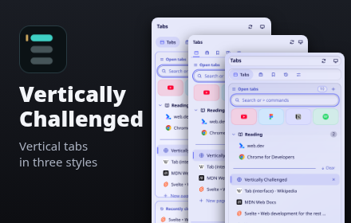

<p align="center">
  
</p>

<h1 align="center">Vertically Challenged</h1>

<p align="center">
  <strong>Vertical tabs for Chrome and Firefox</strong><br>
  Every tab in every window, in one searchable, local-first list.
</p>

<p align="center">
  <a href="https://chromewebstore.google.com/detail/vertically-challenged/bekjjhfjknegeaaaieadcgakkipcgfjm"></a>
  <a href="https://github.com/humdedum1/vertically-challenged/releases"></a>
</p>

<p align="center">
  <a href="https://github.com/humdedum1/vertically-challenged/releases"></a>
  <a href="LICENSE"></a>
  
  
</p>

<p align="center">
  <a href="#-install"></a>
  <a href="#-features"></a>
  <a href="#-browser-support"></a>
  <a href="#-keyboard-shortcuts"></a>
  <a href="#-sync-and-its-limits"></a>
  <a href="#-privacy-and-permissions"></a>
  <a href="#-development"></a>
</p>

<p align="center"></p>

<table>
  <tr>
    <td width="50%" align="center"><strong>🗂️ One list, three styles</strong><br><br></td>
    <td width="50%" align="center"><strong>🔎 Search everything</strong><br><br></td>
  </tr>
  <tr>
    <td width="50%" align="center"><strong>🕘 History by day</strong><br><br></td>
    <td width="50%" align="center"><strong>🎛️ Settings for all of it</strong><br><br></td>
  </tr>
</table>

> [!WARNING]
> **Young, AI-assisted repository.** Mostly written with AI coding tools. Tested on few machines and profiles. Expect rough edges.
>
> **Firefox is less tested.** Checked mainly by an automated headless smoke test.
>
> **Keep backups** of anything you can't lose. [Report what breaks](https://github.com/humdedum1/vertically-challenged/issues/new/choose).

## 💡 Why it exists

> I made this because I loved Sidebery and Zen Browser and couldn't get anything like them in Chromium. I kept adding the little things I wanted, and it slowly grew into this. Now there's a Firefox release too.

## 🚀 Install

<table>
<tr>
<td width="50%" valign="top">

### Chrome 116+

- **Chrome Web Store:** [install from the store](https://chromewebstore.google.com/detail/vertically-challenged/bekjjhfjknegeaaaieadcgakkipcgfjm).
- **Chrome release:** extract the signed `.crx` from `vertically-challenged-<version>-crx.zip`. Chrome often blocks it outside the Web Store. Fall back to an unpacked build.

</td>
<td width="50%" valign="top">

### Firefox 140+

- **Firefox release:** open the signed `.xpi` from [Releases](https://github.com/humdedum1/vertically-challenged/releases).
- **addons.mozilla.org:** [listing](https://addons.mozilla.org/firefox/addon/vertically-challenged/) isn't public until Mozilla's review finishes.

</td>
</tr>
</table>

<details>
<summary><strong>Build from source</strong></summary>

Requires Node.js 22+ and npm.

```sh
git clone https://github.com/humdedum1/vertically-challenged.git
cd vertically-challenged
npm ci
npm run build            # Chrome: .output/chrome-mv3
npm run build:firefox    # Firefox: .output/firefox-mv3
```

- **Load in Chrome:** `chrome://extensions` → Developer mode → Load unpacked → `.output/chrome-mv3`.
- **Load in Firefox:** `about:debugging` → This Firefox → Load Temporary Add-on → `.output/firefox-mv3/manifest.json`. Removed when Firefox closes.
- **Open the panel:** toolbar icon or <kbd>Alt</kbd>+<kbd>Shift</kbd>+<kbd>V</kbd>.

</details>

## ✨ Features

<table>
<tr>
<td width="50%" valign="top">

### 🗂️ Organize

- **One list** for every window, with window names.
- **Staples grid** of daily pages with fixed home URLs.
- **Nested pinned folders** with custom icons, draggable between sections and windows.
- **Child tabs** nested under their opener.
- **Native tab groups:** create, rename, recolor, collapse, move.

</td>
<td width="50%" valign="top">

### 🔎 Find and select

- **Fuzzy search** over tabs, bookmarks, history, saved sessions and snoozed tabs.
- **Command palette:** type `>`.
- **Multi-select** ranges or single tabs for bulk actions.
- **Dedicated panels** for bookmarks, history and recently closed.

</td>
</tr>
<tr>
<td width="50%" valign="top">

### 🧹 Declutter

- **Clear** closes ordinary tabs. Keeps Staples and pins.
- **Suspend tabs** by hand or after inactivity, with exclusions.
- **Snooze and park** tabs. Snoozed tabs return on time, even after a restart.
- **Tidy up** tabs untouched for 7, 30 or 90 days, grouped by site.

</td>
<td width="50%" valign="top">

### 🎨 Customize

- **Three styles:** Classic, Dense and Glass.
- **Themes and CSS:** built-in or custom themes, accent colors, custom CSS, import and export.
- **Layout controls:** density, fonts, row layout, panel order, visible sections, tab actions.
- **Rebindable input:** in-panel shortcuts, browser commands, context-menu actions.

</td>
</tr>
<tr>
<td width="50%" valign="top">

### 💾 Save and restore

- **Window setups** store names, Staples, pins and folders.
- **Saved sessions** restore tabs, groups and pinned layout. Export as Markdown or bookmarks.
- **Other devices:** browse, open or keep workspaces from your other computers.
- **Full backups:** scheduled, optionally encrypted, to Downloads, WebDAV, S3-compatible storage or Dropbox.
- **Restore safety:** restore from the server, undo a restore, get a toolbar warning if backups stop.

</td>
<td width="50%" valign="top">

### 🔒 Private by default

- **No analytics** and no project server.
- **No host permissions** requested at install.
- **Incognito stays separate** from normal windows and sync.

</td>
</tr>
</table>

## 🌐 Browser support

| | Chrome 116+ | Firefox 140+ |
| --- | --- | --- |
| Surface | Side panel, in-page popup, window | Sidebar, window |
| Browser's synced tabs from other devices | ✅ | ❌ No API. Extension workspaces and sessions still sync. |
| Favicons | Browser cache | Each site's own server |
| Remote images in custom CSS | Blocked | Blocked, stylesheet left unapplied |

- **Closing by shortcut:** closing the Chrome side panel with the shortcut needs Chrome 141+.
- **Popup setting on Firefox:** arriving through a backup, it opens the window instead.

## ⌨️ Keyboard shortcuts

| Command | Default |
| --- | --- |
| Open or close the panel | Alt+Shift+V |
| Open the panel with search focused | Unassigned |
| Suspend the current tab | Unassigned |
| Suspend the other tabs in the window | Unassigned |
| Switch to the previously used tab (repeat to go further back) | Unassigned |
| Switch forward through recently used tabs | Unassigned |

- **In-panel shortcuts:** rebind in Settings.
- **Browser commands:** `chrome://extensions/shortcuts` in Chrome, Settings → Shortcuts in Firefox.

## 🔄 Sync and its limits

- **Transport:** Chrome Sync or Firefox Sync. The two browsers share nothing.
- **Setup:** same account, extension sync on, extension installed on each computer.
- **Chrome remote tabs:** also need the Open tabs sync setting.
- **Settings and themes** sync on change.

<details>
<summary>What syncs, what doesn't, and backups</summary>

- **Open workspaces** publish manually or every 1, 5, 15, 30 or 60 minutes. Alarms can fire late during sleep.
- **Received data** appears under Sessions → Other devices. Nothing opens or closes by itself.
- **Keep here** saves the pinned layout as a setup, plus a snapshot if ordinary tabs exist.
- **Never captured:** incognito and private tabs, extension pages, browser tab IDs.
- **Storage cap:** about 100 KB on Chrome. Firefox's limit is unmeasured, same budget used. Settings shows errors and skipped snapshots.
- **File backups** cover settings, custom themes, Staples, pins, nested folders and window setups. Incognito layouts excluded.
- **Imports** add layouts under Sessions → Window setups. Open windows and existing setups stay untouched. Settings-only backups still import.
- **Uninstalling** deletes local data permanently.

</details>

## 🔒 Privacy and permissions

- **No analytics.** No server run by the project.
- **Sync caveat:** shared tab URLs, titles, workspaces and settings travel through Chrome Sync or Firefox Sync.
- **Firefox favicons** come from each site's server.
- **Bookmarks and history** stay out of workspace snapshots.
- **Full policy:** [docs/PRIVACY.md](docs/PRIVACY.md).
- **Permissions:** no host permissions are requested at install.

<details>
<summary>Every permission and why</summary>

| Permission | Why |
| --- | --- |
| `tabs` | Titles and URLs for list and search. Switching and closing tabs. |
| `sidePanel` (Chrome) | Chrome side panel UI. Firefox's sidebar needs no permission. |
| `favicon` (Chrome) | Favicons without host permissions. |
| `storage` | Synced settings, local layouts and sessions. |
| `tabGroups` | Native tab groups. |
| `sessions` | Recently closed tabs and windows. |
| `bookmarks` | Bookmarks panel. |
| `history` | History panel: read, search, delete. |
| `alarms` | Auto-suspend and scheduled sync. The background page sleeps, so `setTimeout` is unreliable. |
| `contextMenus` | Browser menu items. |
| `activeTab`, `scripting` | Chrome in-page popup, injected after you invoke it on that tab. |
| `notifications` (optional) | Open on launch. Chrome needs a user gesture, so a notification click supplies it. |
| `downloads` (optional) | Automatic backups to Downloads. |
| Server address (optional) | WebDAV, S3-compatible or Dropbox backups. Only the address you enter. |
| `identity` (optional on Chrome) | Dropbox sign-in with your own app key. Required at install on Firefox, which doesn't allow it as optional. |

</details>

## 🛠️ Development

<details>
<summary><strong>Commands, tests and tooling</strong></summary>

Stack: TypeScript, Svelte 5, WXT, Vitest, Playwright, Selenium, Biome.

| Command | Purpose |
| --- | --- |
| `npm run dev` | Dev browser with hot reload |
| `npm run start:firefox` | Firefox build through web-ext (`WEB_EXT_FIREFOX` sets the binary) |
| `npm run zip` / `zip:firefox` | Zip a build (unsigned) |
| `npm run pack:crx` | Signed CRX in a release ZIP (needs the signing key) |
| `npm run lint` | Formatting and lint |
| `npm run check` | Svelte and TypeScript checks |
| `npm test` | Unit and integration tests |
| `npm run test:e2e` | Chromium against the built extension |
| `npm run test:e2e:firefox` | Headless Firefox smoke (`FIREFOX_BIN` sets a 140+ binary) |
| `npm run bench:pure` | Pure-function benchmarks |
| `just ci` | Install, lint, typecheck, unit tests, both builds, web-ext lint |
| `just qa` | Builds, Chromium e2e, Firefox 140 smoke |

```sh
npx playwright-core install chromium
npm run build
npm run test:e2e
```

- **E2E browser:** Chromium or Chrome for Testing. Branded Chrome ignores the test-extension flag. `CHROME_BIN` overrides.
- **Firefox coverage gap:** temporary add-ons can't run injected script files, so the smoke test can't cover them.
- **Screenshots:** `node tests/e2e/shots.mjs`, then `node scripts/store-assets.mjs` for the store images.
- **Profiling:** [bench/README.md](bench/README.md).

</details>

## 🤝 Contributing and security

- **Pull requests:** feature branch, focused change, checks listed. See [CONTRIBUTING.md](CONTRIBUTING.md).
- **AI-assisted PRs** are welcome once reviewed and tested by you.
- **Firefox fixes** are especially welcome.
- **Versions:** SemVer, Conventional Commits, automatic releases from `main`.
- **Vulnerabilities:** follow [SECURITY.md](SECURITY.md).

<p align="center"></p>

<p align="center">
  <a href="https://ko-fi.com/humdedum1"></a>
  <a href="https://paypal.me/oddboxx"></a>
  <br><sub>Optional. Unlocks nothing.</sub>
</p>

<p align="center"><sub><a href="LICENSE">GPL-3.0-or-later</a> · Third-party palettes: <a href="THIRD_PARTY_NOTICES.md">THIRD_PARTY_NOTICES.md</a></sub></p>
