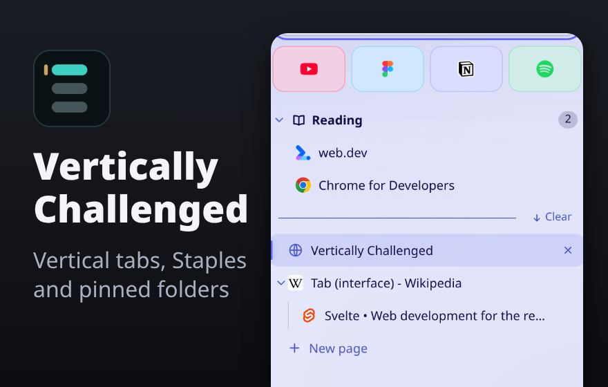
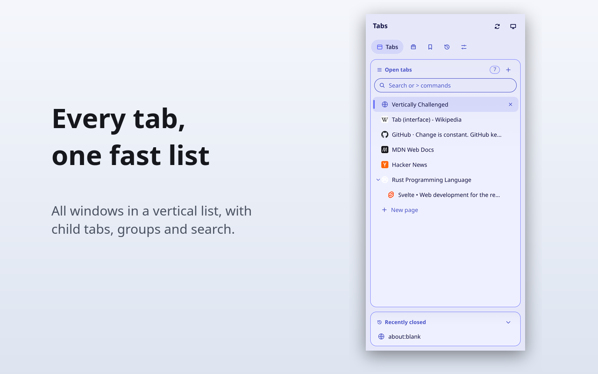
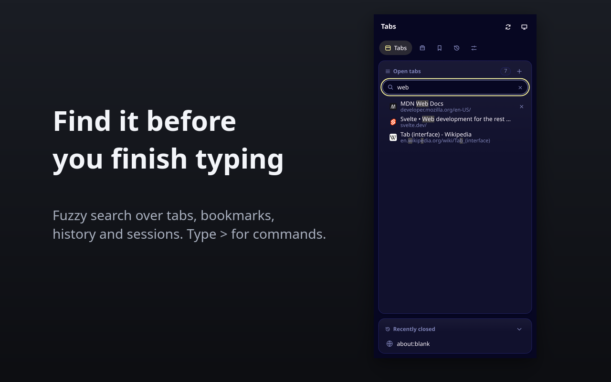
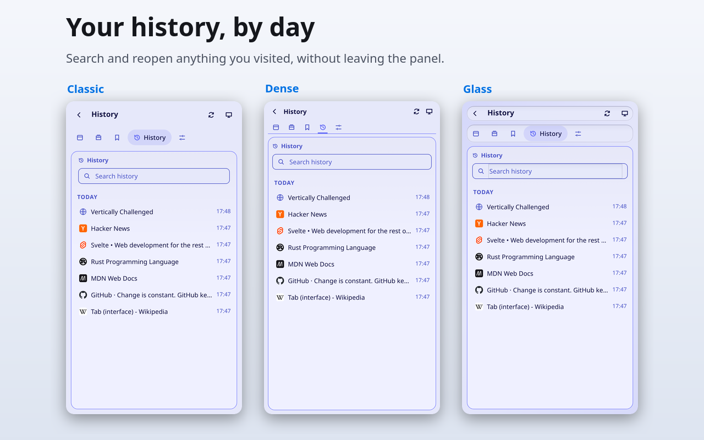
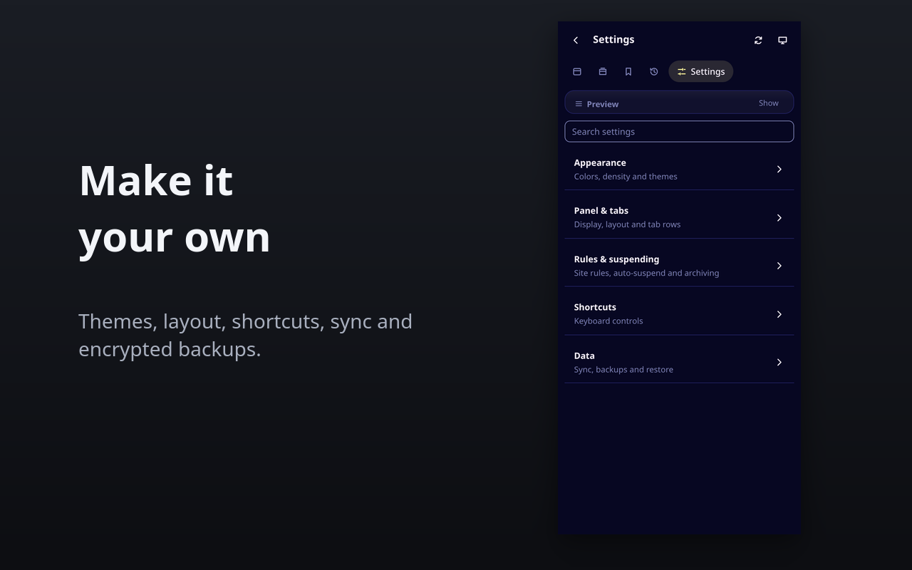

<p align="center">
  
</p>

# Vertically Challenged

Vertical tabs for Chrome and Firefox. Every tab in every window sits in one searchable list in the side panel, with no account, no server and no tracking.

I built it because I loved Sidebery and Zen Browser and couldn't find anything like them for Chromium. It grew from there, and now runs on Firefox too.

<p align="center">
  <a href="https://chromewebstore.google.com/detail/vertically-challenged/bekjjhfjknegeaaaieadcgakkipcgfjm"></a>
  <a href="https://github.com/humdedum1/vertically-challenged/releases"></a>
  <a href="LICENSE"></a>
  <a href="https://ko-fi.com/humdedum1"></a>
  <a href="https://paypal.me/oddboxx"></a>
</p>

> [!NOTE]
> This is a young project, written mostly with AI coding tools and tested on a handful of machines. Firefox gets less testing than Chrome. Keep backups of anything you can't lose, and [report what breaks](https://github.com/humdedum1/vertically-challenged/issues/new/choose).

## Install

- **Chrome 116+:** install from the [Chrome Web Store](https://chromewebstore.google.com/detail/vertically-challenged/bekjjhfjknegeaaaieadcgakkipcgfjm).
- **Firefox 140+:** open the signed `.xpi` from [Releases](https://github.com/humdedum1/vertically-challenged/releases). The [addons.mozilla.org listing](https://addons.mozilla.org/firefox/addon/vertically-challenged/) goes public once Mozilla's review finishes.

Open the panel with the toolbar icon or <kbd>Alt</kbd>+<kbd>Shift</kbd>+<kbd>V</kbd>.

## What it does

| | |
| --- | --- |
|  |  |
|  |  |

- **Organize.** Tabs from all windows in one list. Child tabs nest under the tab that opened them. Pin daily sites to a grid of Staples, sort pins into nested folders, and use native tab groups.
- **Find.** Fuzzy search across tabs, bookmarks, history, saved sessions and snoozed tabs. Type `>` for the command palette. Select a range of tabs to act on them all at once.
- **Declutter.** Suspend idle tabs, snooze tabs until later (they come back even after a restart), and close tabs you haven't touched in 7, 30 or 90 days.
- **Save and restore.** Save window layouts and sessions, pick up workspaces from your other computers, and schedule full backups (optionally encrypted) to Downloads, WebDAV, S3-compatible storage or Dropbox.
- **Customize.** Three styles (Classic, Dense, Glass), themes, accent colors, custom CSS, density, fonts and rebindable shortcuts.

## Chrome and Firefox differences

| | Chrome | Firefox |
| --- | --- | --- |
| Opens as | Side panel, in-page popup or window | Sidebar, in-page popup or window |
| Synced tabs from the browser's other devices | Yes | No (no API). The extension's own workspaces still sync. |
| Favicons load from | The browser's cache | Each site's server |
| Open at browser launch | Yes (side panel via a notification click) | Window mode only |

Closing the Chrome side panel with the keyboard shortcut needs Chrome 141 or later.

## Sync

Settings, themes and workspaces sync through Chrome Sync or Firefox Sync. You need the same account, extension sync turned on, and the extension installed on each computer. Chrome and Firefox don't share data with each other.

Workspaces from other computers show up under **Sessions → Other devices**. Nothing opens or closes on its own. Incognito and private tabs are never captured. Chrome caps sync storage at about 100 KB; Settings shows an error if a snapshot doesn't fit.

Uninstalling the extension deletes its local data, so export a backup first.

## Privacy

There are no analytics and no project server. Data only leaves your computer through your browser's own sync, or a backup destination you set up. Firefox loads favicons from each site directly. The extension asks for no website access at install. Read the full [privacy policy](docs/PRIVACY.md).

<details>
<summary>Permissions and why each is needed</summary>

| Permission | Why |
| --- | --- |
| `tabs` | Read tab titles and URLs; switch and close tabs. |
| `sidePanel` (Chrome) | Show the side panel. |
| `favicon` (Chrome) | Show favicons without website access. |
| `storage` | Settings, layouts and sessions. |
| `tabGroups` | Native tab groups. |
| `sessions` | Recently closed tabs and windows. |
| `bookmarks`, `history` | The Bookmarks and History panels. |
| `alarms` | Auto-suspend, snooze and scheduled sync. |
| `contextMenus` | Right-click menu items. |
| `activeTab`, `scripting` | The in-page popup, only on the tab where you open it. |
| `notifications` (optional) | Open the panel at browser startup. Chrome needs a click to open the side panel. |
| `downloads` (optional) | Backups to your Downloads folder. |
| Server address (optional) | WebDAV, S3 or Dropbox backups. Only the address you enter. |
| `identity` (optional on Chrome) | Dropbox sign-in. Firefox requires it at install. |

</details>

## Build from source

Needs Node.js 22 or later.

```sh
git clone https://github.com/humdedum1/vertically-challenged.git
cd vertically-challenged
npm ci
npm run build           # Chrome  → .output/chrome-mv3
npm run build:firefox   # Firefox → .output/firefox-mv3
```

- **Chrome:** `chrome://extensions` → Developer mode → Load unpacked → `.output/chrome-mv3`.
- **Firefox:** `about:debugging` → This Firefox → Load Temporary Add-on → `.output/firefox-mv3/manifest.json`. It's removed when Firefox closes.

## Contributing

Pull requests are welcome, especially Firefox fixes. AI-assisted PRs are fine if you've reviewed and tested them yourself. [CONTRIBUTING.md](CONTRIBUTING.md) covers the dev commands, tests and commit style. Report security issues as described in [SECURITY.md](SECURITY.md).

## License

[GPL-3.0-or-later](LICENSE). Third-party palettes are listed in [THIRD_PARTY_NOTICES.md](THIRD_PARTY_NOTICES.md).
