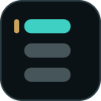
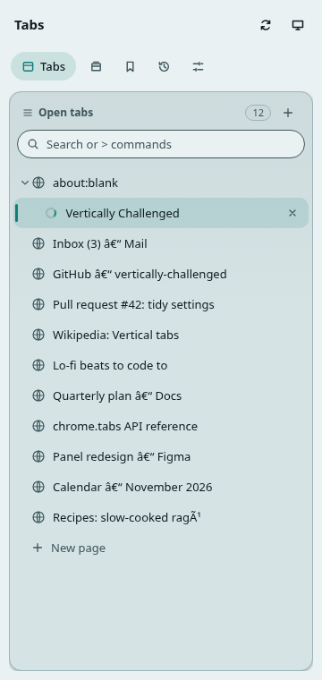
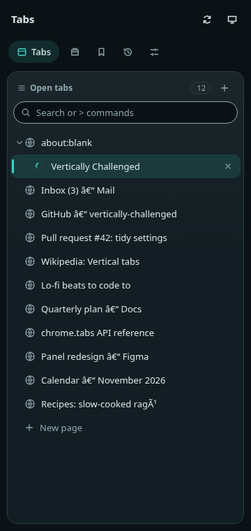
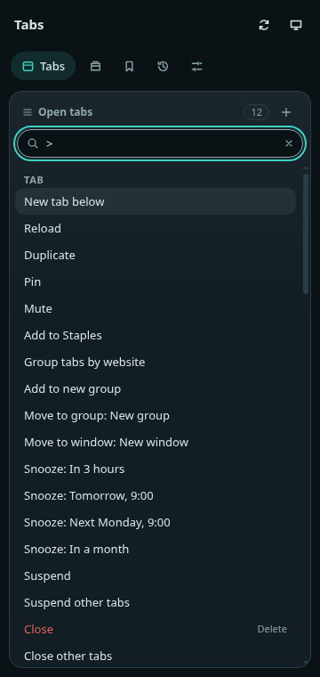

<div align="center">



# Vertically Challenged

**Fast, customizable vertical tabs for Chrome, in the side panel or an in-page popup.**

Staples, pinned folders, tab groups, saved sessions and themes. Local-first, no telemetry.

[](https://github.com/humdedum1/vertically-challenged/actions/workflows/checks.yml)
[](https://github.com/humdedum1/vertically-challenged/releases)
[](LICENSE)


[](https://ko-fi.com/humdedum1)
[](https://paypal.me/oddboxx)

[Install](#install) · [Features](#features) · [Shortcuts](#keyboard-shortcuts) · [Releases](https://github.com/humdedum1/vertically-challenged/releases) · [Report a bug](https://github.com/humdedum1/vertically-challenged/issues/new/choose) · [Contribute](CONTRIBUTING.md)

  
<!-- TODO: add Chrome Web Store version/users badges once the store listing exists. -->

</div>

> [!WARNING]
> **Vibecoded, lightly tested.** This extension was built with heavy use of AI coding tools. It has unit and end-to-end tests, but they come from a small sample: a few machines, a few profiles, a few workflows. Bugs happen, edge cases are untested, and releases may need follow-up fixes. Keep backups of anything you cannot afford to lose, and please report what you find.

> [!NOTE]
> **Free and open source.** Licensed under the [MIT License](LICENSE). It is free to use and will stay free for the foreseeable future. Donations are optional ([Ko-fi](https://ko-fi.com/humdedum1), [PayPal](https://paypal.me/oddboxx)) and unlock nothing.

## Install

Requires Chrome 116 or newer. Closing the side panel by shortcut needs Chrome 141 or newer.

- **Chrome Web Store:** [TODO: Chrome Web Store listing URL]
- **Manual install from GitHub Releases:** download `vertically-challenged-<version>-crx.zip` from the [Releases](https://github.com/humdedum1/vertically-challenged/releases) page and extract the signed `.crx` from it. Chrome can restrict installing extensions from outside the Web Store, so you may need to use a store build or an unpacked build instead. The CRX ZIP is not the same as an unpacked source ZIP and cannot be selected directly with Load unpacked.
- **Unpacked (build from source):** see [Build from source](#build-from-source).

After installing, click the toolbar icon or press **Alt+Shift+V** to open the panel, then open Settings to choose your theme, display mode, layout, shortcuts, and sync timing.

## Features

| Feature | What it does |
| --- | --- |
| All-window tab list | Shows your normal windows together, with window names and active tabs. Incognito windows are kept separate. |
| Staples | A compact grid for frequently used pages, with persistent home URLs and dormant tiles you can reopen. |
| Pinned tabs and folders | Arrange pins into nested folders, change folder icons, and drag items between sections or windows. |
| Child tabs | New tabs opened from another page can appear beneath their opener. Drag to nest or unnest tabs. |
| Native tab groups | Create, rename, recolor, collapse, and move Chrome groups. |
| Search | Find tabs by title and URL with fuzzy matching and keyboard navigation. Also finds pages in your bookmarks, history, saved sessions and snoozed tabs. Settings has its own search box. |
| Multiple selection | Select ranges or individual tabs and act on them together. |
| Clear | Close ordinary tabs while keeping your Staples and pinned layout. |
| Window setups | Save window names, Staples, pins, and folder structures for reuse. |
| Saved sessions | Save windows or all windows and restore their tabs, groups, and live pinned layouts. |
| Other devices | Browse published workspaces and sessions, open or add them locally, and keep copies. |
| Suspend tabs | Discard tabs manually or after an idle interval, with pinned, audible, and site exclusions. Chrome reloads them when activated. |
| Snooze and park | Put a tab away until later today, tomorrow, Monday or next month, or park it with no reminder. Snoozed tabs reopen on time, even if the browser was closed. |
| Full backups | Encrypted backups of everything to Downloads, WebDAV (Nextcloud), S3-compatible storage or Dropbox, on a schedule. Restore from the server, undo a restore, and get a toolbar warning if backups stop. |
| Tidy up | Command palette → “Tidy up tabs…” lists tabs you haven't used for 7, 30 or 90 days by site, so you can park or close a whole site at once. |
| Export sessions | Save a session as a Markdown outline or a bookmarks file. |
| Bookmarks and history | Search and open saved bookmarks and visited pages from dedicated panels. |
| Recently closed | Reopen recently closed tabs and windows. |
| Themes | Built-in palettes, custom themes, accent colors, light/dark/system mode, import and export. |
| Appearance | Density, fonts, row layout, panel order, visible sections, and tab actions. |
| Shortcuts and context menus | Configurable in-panel shortcuts, Chrome commands, and browser context-menu actions. |
| Panel recovery | Reload the panel with the button beside colour mode, or from its context menu. |

## Keyboard shortcuts

**Alt+Shift+V** toggles the panel by default. Change Chrome-level bindings at `chrome://extensions/shortcuts`; edit in-panel bindings in Settings. Search, selection, tab navigation, and context menus support the keyboard.

| Chrome command | Default | Action |
| --- | --- | --- |
| Open or close the vertical tab panel | Alt+Shift+V | Toggle the panel |
| Open the panel and search tabs | none | Open the panel with search focused |
| Suspend the current tab | none | Discard the current tab |
| Suspend all other tabs in the window | none | Discard the other tabs in the window |
| Switch to the previously used tab | none | Go back through recently used tabs (press again to go further) |
| Switch forward through recently used tabs | none | Go forward through recently used tabs |

Choose the Chrome side panel or an in-page popup in Settings. On pages where Chrome disallows injection, the popup uses a separate window. In-page injection needs a user gesture and does not request access to every website.

## Sync and its limits

Sign in to the same Google account in Chrome on each computer and enable Chrome Sync for extensions. Install Vertically Challenged on each device. Chrome's own remote-tab list additionally needs its **Open tabs** sync setting.

- **Settings and custom themes** are stored directly in Chrome Sync and update when changed.
- **Open workspaces** publish ordinary tabs, groups, Staples, pinned tabs, folders, and window names. Saved setups and sessions can also be shared.
- Choose **Manual only**, **1**, **5**, **15**, **30**, or **60 minutes** in Settings → Sync. This controls workspace/session publication; it does not control Google's delivery timing or settings/theme sync.
- **Sync now** publishes immediately. Automatic publication uses Chrome alarms so the extension's idle background worker can wake to sync. Alarms can run late when the computer sleeps.
- Published data appears under **Sessions → Other devices**. It does not automatically open or close tabs on another computer. Open or add a workspace when you want it; pinned tiles remain available to open on demand.
- **Keep here** saves a workspace's pinned layout as a setup. When it includes ordinary tabs, a full snapshot is also saved in Saved sessions.
- Incognito tabs are excluded. Extension pages are excluded from ordinary-tab capture. Device snapshots do not share browser tab IDs.
- **File backups** include settings, custom themes, Staples, pinned tabs, nested pinned folders, and saved Window setups. Import adds layouts to Sessions → Window setups without replacing open windows or existing setups. Incognito layouts are excluded. Older settings-only backups remain supported.
- Chrome Sync has about **100 KB total storage**, shared by settings, themes, and compressed device snapshots. Large collections may not fit. Settings shows storage errors and omitted snapshots; this is not an unlimited or complete backup service.

Updates and reloads preserve saved layouts when their live tabs can be identified. **Uninstalling removes the extension's local data.** Reinstalling is not a recovery method. Settings/theme export backs up settings and themes, not every tab, session, or folder.

## Permissions

Each permission is needed for a specific feature. No host permissions are requested at install (a backup server is requested only if you set one up); the popup injects only after you use its toolbar button, a shortcut, or the toolbar menu on that tab.

| Permission | Why it is needed |
| --- | --- |
| `tabs` | Read tab titles and URLs for the list and search, and switch or close tabs. |
| `sidePanel` | Render the UI in Chrome's side panel. |
| `favicon` | Load page favicons without host permissions. |
| `storage` | Persist settings (synced across your Chrome profile) and local layout and session data. |
| `tabGroups` | Show, create, rename, recolor, collapse, and move native tab groups. |
| `sessions` | Recently closed tabs and windows, and restoring them. |
| `bookmarks` | The Bookmarks panel (read, open, search). |
| `history` | The History panel (read, search, delete entries). |
| `alarms` | Auto-suspend timers and scheduled sync. The background worker sleeps when idle, so timers cannot run with `setTimeout`. |
| `contextMenus` | "Suspend tab", "Save window as session" and similar items in Chrome's page and toolbar menus. |
| `activeTab` | Grants temporary access to the current tab after you invoke the extension on it. |
| `scripting` | Injects the in-page popup into that tab, only after you invoke it there. |
| `notifications` (optional) | Only when **Open on launch** is on: Chrome cannot open the panel without a user gesture, so launch shows a notification whose click opens it. |
| `downloads` (optional) | Only when **Automatic backups** are turned on: saves the backup file to your Downloads folder. |
| Server address (optional host permission) | Only when you set up a **WebDAV**, **S3-compatible** or **Dropbox** backup target: access to the one server address you enter, so backups can be uploaded and old copies deleted. Nothing is requested at install. |
| `identity` (optional) | Only for **Dropbox** backups: opens Dropbox's sign-in window. Dropbox sign-in uses your own Dropbox app key; the extension ships no shared credentials. |

## Build from source

Requires Node.js 22 or newer and npm.

```sh
git clone https://github.com/humdedum1/vertically-challenged.git
cd vertically-challenged
npm ci
npm run build
```

1. Open `chrome://extensions` and enable **Developer mode**.
2. Select **Load unpacked** and choose `.output/chrome-mv3`.
3. For updates, rebuild into the same directory and use **Reload** on `chrome://extensions`.

| Command | Purpose |
| --- | --- |
| `npm run build` | Production extension in `.output/chrome-mv3` |
| `npm run zip` | Package the unpacked extension as a ZIP, not a signed CRX |
| `npm run pack:crx` | Build and package a signed CRX inside a release ZIP (needs the signing key; see [CONTRIBUTING.md](CONTRIBUTING.md)) |

## Development and testing

Built with TypeScript, Svelte 5, WXT, Vitest, Playwright, and Biome. No new runtime service is required.

| Command | Purpose |
| --- | --- |
| `npm run dev` | Development browser and hot reload |
| `npm run lint` | Formatting and lint checks |
| `npm run check` | Svelte and TypeScript checks |
| `npm test` | Unit and integration tests |
| `npm run test:e2e` | Real Chromium flows against the built extension |
| `npm run bench:pure` | Pure-function performance benchmarks |

Browser test setup:

```sh
npx playwright-core install chromium
npm run build
npm run test:e2e
```

Tests use temporary browser profiles. Chromium or Chrome for Testing is required; branded Chrome ignores the test extension-loading flag. Set `CHROME_BIN` to use a compatible local binary. See [bench/README.md](bench/README.md) for profiling and benchmarks.

## Privacy

The full policy is in [docs/PRIVACY.md](docs/PRIVACY.md).

Local-first, with no analytics or project-operated sync server. Enabling sync sends the shared tab URLs, titles, workspace data, and settings through Chrome Sync. Local-first does not mean that synced data never leaves your computer.

Bookmarks and history remain Chrome-managed data; reading them in the panel does not put the whole browser history or bookmark library into workspace snapshots. Do not paste private browsing data into issues.

## Contributing

Use a feature branch and submit a focused PR with the problem, resulting behavior, and checks actually run. AI-assisted contributions are welcome; contributors remain responsible for reviewing the code, protecting private data, and testing it. See [CONTRIBUTING.md](CONTRIBUTING.md) for the workflow, and the [issue chooser](https://github.com/humdedum1/vertically-challenged/issues/new/choose) for bugs and feature requests.

Versions follow Semantic Versioning and commit messages follow Conventional Commits. Releases are created automatically from `main`; contributors should not bump versions or create tags in ordinary PRs.

## Security

See [SECURITY.md](SECURITY.md) for vulnerability reporting. Do not publish exploit details in issues or pull requests.

## Support the project

Vertically Challenged is free, MIT licensed, and has no paywalled features. If it saves you time and you want to chip in, donations are welcome but never expected.

| | |
| --- | --- |
| ☕ **Ko-fi** | [ko-fi.com/humdedum1](https://ko-fi.com/humdedum1) |
| 💙 **PayPal** | [paypal.me/oddboxx](https://paypal.me/oddboxx) |

Bug reports, testing on your own setup, documentation fixes and code review help just as much.

## License

[MIT](LICENSE). Third-party palettes retain their own notices in [THIRD_PARTY_NOTICES.md](THIRD_PARTY_NOTICES.md).
