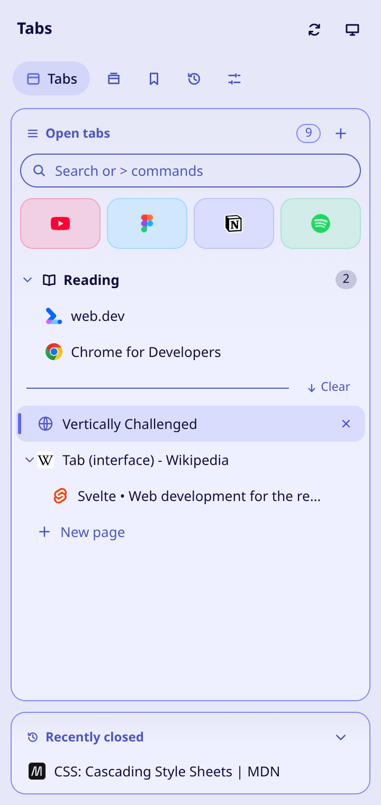
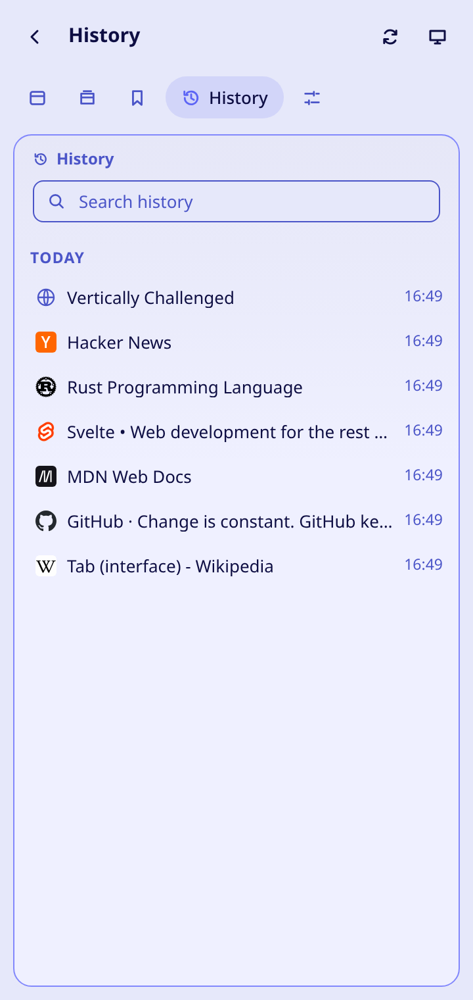
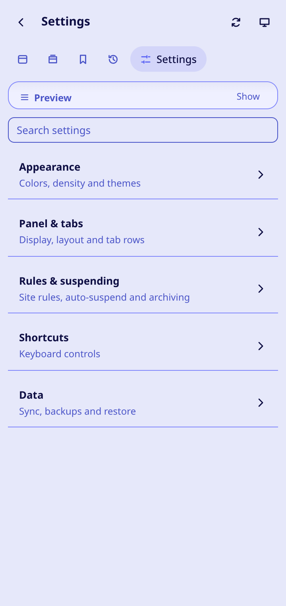

<div align="center">


# Vertically Challenged

**Fast, customizable vertical tabs for Chrome, in the side panel or an in-page popup.**

Staples, pinned folders, tab groups, saved sessions and themes.

[](https://github.com/humdedum1/vertically-challenged/actions/workflows/checks.yml)
[](https://github.com/humdedum1/vertically-challenged/releases)
[](LICENSE)

[](https://ko-fi.com/humdedum1)
[](https://paypal.me/oddboxx)

[Install](#install) · [Features](#features) · [Shortcuts](#keyboard-shortcuts) · [Privacy](#privacy) · [Releases](https://github.com/humdedum1/vertically-challenged/releases) · [Report a bug](https://github.com/humdedum1/vertically-challenged/issues/new/choose) · [Contribute](CONTRIBUTING.md)

<picture>
  <source media="(prefers-color-scheme: dark)" srcset="docs/store/readme-tabs-dark.png">
  
</picture> <picture>
  <source media="(prefers-color-scheme: dark)" srcset="docs/store/readme-history-dark.png">
  
</picture> <picture>
  <source media="(prefers-color-scheme: dark)" srcset="docs/store/readme-settings-dark.png">
  
</picture>

<sub>Tab list with child tabs and fuzzy search (type <code>&gt;</code> for commands) · History grouped by day · Settings with its own search. Noctalia theme, shown in your GitHub light or dark mode.</sub>

<table>
  <tr>
    <td align="center" width="50%"><b>Local-first</b><br><sub>No telemetry, no project-run server</sub></td>
    <td align="center" width="50%"><b>Side panel or popup</b><br><sub>Your pick, in Settings</sub></td>
  </tr>
  <tr>
    <td align="center"><b>No host permissions</b><br><sub>Nothing requested at install</sub></td>
    <td align="center"><b>Free, MIT</b><br><sub>And it stays free</sub></td>
  </tr>
</table>
<!-- TODO: add Chrome Web Store version/users badges once the store listing exists. -->

</div>

> [!WARNING]
> Mostly written with AI coding tools, and only lightly tested. It has unit and end-to-end tests, but they've run on a handful of machines and profiles, so expect rough edges. Keep backups of anything you can't lose, and please report what breaks.

## Install

<table>
  <tr>
    <td valign="top" width="33%"><b>1. Get it</b><br>Web Store, Releases or an unpacked build.</td>
    <td valign="top" width="33%"><b>2. Open it</b><br>Toolbar icon or <kbd>Alt</kbd>+<kbd>Shift</kbd>+<kbd>V</kbd>.</td>
    <td valign="top" width="33%"><b>3. Tune it</b><br>Theme, layout, shortcuts and sync are in Settings.</td>
  </tr>
</table>

Needs Chrome 116 or newer (141 or newer to close the side panel with a shortcut).

- **Chrome Web Store:** not listed yet. <!-- TODO: add the Chrome Web Store listing URL once it exists. -->
- **GitHub Releases:** download `vertically-challenged-<version>-crx.zip` from [Releases](https://github.com/humdedum1/vertically-challenged/releases) and extract the signed `.crx`. Chrome may block extensions from outside the Web Store; if it does, use the store or an unpacked build. The ZIP isn't an unpacked source folder, so Load unpacked won't take it.
- **Unpacked:** see [Build from source](#build-from-source).

## Features

<table>
  <tr>
    <td valign="top" width="50%">
      <b>Organize</b>
        <ul>
          <li><b>All-window tab list.</b> Every normal window in one list, with window names and active tabs. Incognito stays separate.</li>
          <li><b>Staples.</b> A compact grid of the pages you use constantly, each with a fixed home URL. Dormant tiles reopen on click.</li>
          <li><b>Pinned tabs and folders.</b> Nested folders for pins, custom icons, and drag between sections or windows.</li>
          <li><b>Child tabs.</b> Tabs opened from a page can sit under it. Drag to nest or unnest.</li>
          <li><b>Tab groups.</b> Create, rename, recolor, collapse and move Chrome groups.</li>
        </ul>
    </td>
    <td valign="top" width="50%">
      <b>Find and select</b>
        <ul>
          <li><b>Search.</b> Fuzzy search over titles and URLs, plus bookmarks, history, saved sessions and snoozed tabs. Settings has its own search box.</li>
          <li><b>Multi-select.</b> Pick ranges or single tabs and act on them together.</li>
          <li><b>Bookmarks, history, recently closed.</b> Search and open them in their own panels, and reopen closed tabs and windows.</li>
        </ul>
    </td>
  </tr>
  <tr>
    <td valign="top">
      <b>Declutter</b>
        <ul>
          <li><b>Clear.</b> Close ordinary tabs; Staples and pins stay.</li>
          <li><b>Suspend tabs.</b> Discard tabs by hand or after an idle period. Pinned, audible and chosen sites can be excluded. Chrome reloads a tab when you switch back.</li>
          <li><b>Snooze and park.</b> Put a tab away until later today, tomorrow, Monday or next month, or park it with no reminder. Snoozed tabs return on time, even after a restart.</li>
          <li><b>Tidy up.</b> "Tidy up tabs…" in the command palette lists tabs unused for 7, 30 or 90 days, grouped by site, so you can park or close a whole site at once.</li>
        </ul>
    </td>
    <td valign="top">
      <b>Make it yours</b>
        <ul>
          <li><b>Themes and appearance.</b> Built-in and custom themes, accent colors, light/dark/system mode, import and export. Tune density, fonts, row layout, panel order, visible sections and tab actions.</li>
          <li><b>Shortcuts and menus.</b> Configurable in-panel shortcuts, Chrome commands and context-menu actions.</li>
          <li><b>Panel recovery.</b> Reload the panel from the button next to color mode, or from its context menu.</li>
        </ul>
    </td>
  </tr>
  <tr>
    <td valign="top" colspan="2">
      <b>Save and move</b>
        <ul>
          <li><b>Window setups.</b> Save window names, Staples, pins and folders to reuse.</li>
          <li><b>Saved sessions.</b> Save one or all windows and restore tabs, groups and pinned layouts. Export as a Markdown outline or a bookmarks file.</li>
          <li><b>Other devices.</b> Browse workspaces and sessions from your other computers, open them, or keep copies.</li>
          <li><b>Full backups.</b> Scheduled, encrypted backups to Downloads, WebDAV (Nextcloud), S3-compatible storage or Dropbox. Restore from the server, undo a restore, and get a toolbar warning if backups stop.</li>
        </ul>
    </td>
  </tr>
</table>

## Keyboard shortcuts

Alt+Shift+V toggles the panel. Change Chrome-level shortcuts at `chrome://extensions/shortcuts` and in-panel ones in Settings. Search, selection, tab navigation and context menus all work from the keyboard.

| Chrome command | Default |
| --- | --- |
| Open or close the panel | Alt+Shift+V |
| Open the panel with search focused | Unassigned |
| Suspend the current tab | Unassigned |
| Suspend the other tabs in the window | Unassigned |
| Switch to the previously used tab (press again to go further back) | Unassigned |
| Switch forward through recently used tabs | Unassigned |

The panel can be Chrome's side panel or an in-page popup (pick in Settings). Where Chrome blocks injection, the popup opens in its own window. Injection only happens after you click or press a shortcut on that tab, so the extension never asks for access to every site.

## Sync and its limits

Sign in to the same Google account on each computer, turn on extension sync, and install the extension everywhere. Chrome's own remote-tab list also needs its Open tabs sync setting. Settings and themes sync as soon as they change; open workspaces publish on a schedule you set, from manual to every 60 minutes.

<details>
<summary>How it works, and the limits</summary>

- Open workspaces publish ordinary tabs, groups, Staples, pins, folders and window names. Saved setups and sessions can be shared too. Settings → Sync sets how often: manual, or every 1, 5, 15, 30 or 60 minutes. Sync now publishes immediately; scheduled runs use Chrome alarms and can fire late while the computer sleeps. The interval doesn't affect settings and theme sync, or how fast Google delivers data.
- Published data shows up under Sessions → Other devices. Nothing opens or closes on the other computer by itself. Keep here saves a workspace's pinned layout as a setup, plus a full snapshot in Saved sessions if it has ordinary tabs.
- Incognito tabs and extension pages are never captured, and snapshots don't share browser tab IDs.
- Chrome Sync allows roughly 100 KB in total for settings, themes and compressed snapshots, so big collections may not fit. Settings shows storage errors and skipped snapshots. For real backups, use Full backups.

File backups cover settings, custom themes, Staples, pins, nested folders and Window setups, but not incognito layouts. Importing adds layouts under Sessions → Window setups without touching open windows or existing setups, and older settings-only backups still import. Updates and reloads keep saved layouts when their tabs can be matched. Uninstalling deletes the extension's local data for good, and reinstalling won't restore it.

</details>

## Permissions

No host permissions are requested at install. The popup injects only after you use its toolbar button, shortcut or menu on that tab.

<details>
<summary>Every permission and why</summary>

| Permission | Why |
| --- | --- |
| `tabs` | Titles and URLs for the list and search; switching and closing tabs. |
| `sidePanel` | Show the UI in Chrome's side panel. |
| `favicon` | Load favicons without host permissions. |
| `storage` | Settings (synced), plus local layouts and sessions. |
| `tabGroups` | Manage native tab groups. |
| `sessions` | Recently closed tabs and windows. |
| `bookmarks` | The Bookmarks panel. |
| `history` | The History panel (read, search, delete). |
| `alarms` | Auto-suspend and scheduled sync. The background worker sleeps when idle, so `setTimeout` won't do. |
| `contextMenus` | Items like "Suspend tab" and "Save window as session" in Chrome's menus. |
| `activeTab`, `scripting` | Inject the in-page popup into the current tab after you invoke it there. |
| `notifications` (optional) | Only for Open on launch: Chrome won't open the panel without a user gesture, so a notification does it on click. |
| `downloads` (optional) | Only for automatic backups to Downloads. |
| Server address (optional) | Only for WebDAV, S3-compatible or Dropbox backups, and only the one address you enter. |
| `identity` (optional) | Only for Dropbox sign-in, with your own Dropbox app key. No shared credentials ship with the extension. |

</details>

## Build from source

Needs Node.js 22+ and npm.

```sh
git clone https://github.com/humdedum1/vertically-challenged.git
cd vertically-challenged
npm ci
npm run build
```

Open `chrome://extensions`, enable Developer mode, click Load unpacked and pick `.output/chrome-mv3`. To update, rebuild into the same folder and click Reload.

## Development and testing

TypeScript, Svelte 5, WXT, Vitest, Playwright and Biome.

<details>
<summary>Commands and end-to-end setup</summary>

| Command | Purpose |
| --- | --- |
| `npm run dev` | Dev browser with hot reload |
| `npm run build` | Production build in `.output/chrome-mv3` |
| `npm run zip` | Zip the unpacked build (not a signed CRX) |
| `npm run pack:crx` | Signed CRX in a release ZIP (needs the signing key, see [CONTRIBUTING.md](CONTRIBUTING.md)) |
| `npm run lint` | Formatting and lint |
| `npm run check` | Svelte and TypeScript checks |
| `npm test` | Unit and integration tests |
| `npm run test:e2e` | Real Chromium runs against the built extension |
| `npm run bench:pure` | Pure-function benchmarks |

```sh
npx playwright-core install chromium
npm run build
npm run test:e2e
```

End-to-end tests use throwaway profiles and need Chromium or Chrome for Testing, since branded Chrome ignores the flag that loads test extensions. Set `CHROME_BIN` to use your own binary. `node tests/e2e/shots.mjs` regenerates the screenshots above in Noctalia light and dark. Profiling and benchmarks are in [bench/README.md](bench/README.md).

</details>

## Privacy

Full policy: [docs/PRIVACY.md](docs/PRIVACY.md). There's no analytics and no project-run server. With sync on, shared tab URLs, titles, workspace data and settings travel through Chrome Sync, so local-first doesn't mean nothing ever leaves your computer. Bookmarks and history stay in Chrome; showing them in the panel doesn't copy them into workspace snapshots. Please keep private browsing data out of issues.

## Contributing

Work on a feature branch and open a focused PR: what was wrong, what changed, and which checks you ran. AI-assisted PRs are welcome as long as you've reviewed and tested them and kept private data out. See [CONTRIBUTING.md](CONTRIBUTING.md) and the [issue chooser](https://github.com/humdedum1/vertically-challenged/issues/new/choose).

Versions follow Semantic Versioning, commits follow Conventional Commits, and releases are cut automatically from `main`, so don't bump versions or tag in ordinary PRs.

## Security

Report vulnerabilities as described in [SECURITY.md](SECURITY.md), and keep exploit details out of public issues and PRs.

## Support the project

Free under the [MIT License](LICENSE), and it will stay free for the foreseeable future. If it saves you time, you can chip in on [Ko-fi](https://ko-fi.com/humdedum1) or [PayPal](https://paypal.me/oddboxx); donations are optional and unlock nothing. Bug reports, testing on your setup, doc fixes and code review help just as much.

## License

[MIT](LICENSE). Third-party palettes keep their own notices in [THIRD_PARTY_NOTICES.md](THIRD_PARTY_NOTICES.md).
